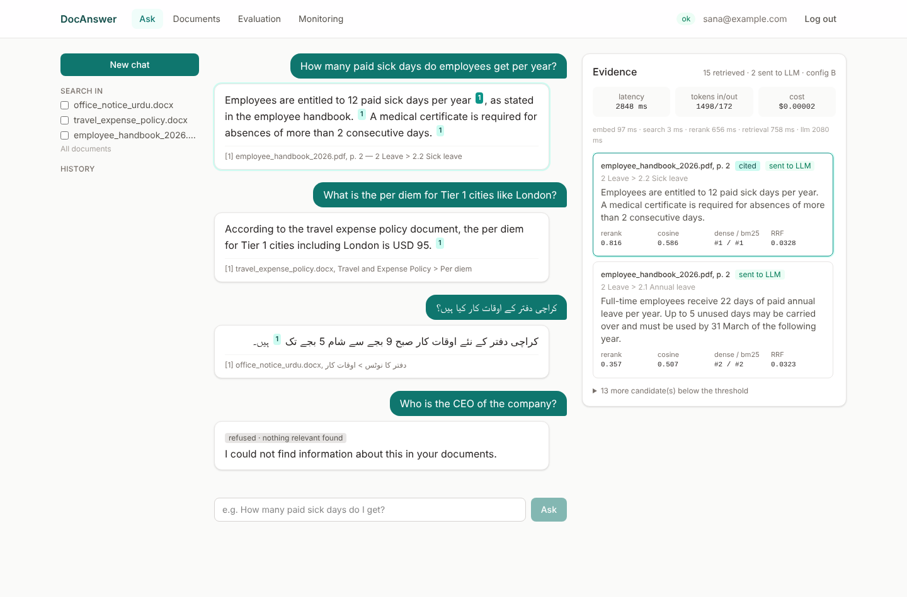

# Production RAG Service — Document Question Answering

Upload your own documents (PDF, DOCX, PPTX, TXT, MD), ask questions in plain language, and get
answers **only from those documents**, with citations you can click to see the exact passage.
If the answer is not in your files, the service says so instead of guessing.


<sub>Live screenshot (Cohere Command A+ with a free trial key, 24 November 2026). The Swagger
screenshots in `docs/screenshots/swagger/` were taken in test mode.</sub>

## Features

* **Ingestion:** PDF, DOCX, PPTX, TXT, MD; page/slide and heading-section metadata; tables kept
  as rows; header/footer cleaning; duplicate detection (409); scanned PDFs rejected (400).
* **Retrieval:** hybrid dense (Cohere Embed 5) + BM25, Reciprocal Rank Fusion, Cohere Rerank 5,
  relevance threshold; the UI shows every retrieved chunk with its scores.
* **Answers:** Cohere Command A+ (default, free on a trial key) or Claude Haiku 5.5, both with
  built-in citations; every citation is verified against the
  chunks actually sent; refusals in English, Urdu or Arabic.
* **Guardrails:** prompt-injection and jailbreak detection (EN/UR/AR) plus an LLM classifier,
  planted-instruction flagging in documents, canary-based output leak check.
* **Multi-user:** JWT auth, every query and vector search scoped to the owner; others' documents
  return 404. Deleting a document removes all of its vectors.
* **Operations:** structured JSON logs with request ids, retries/timeouts with clear 429/503
  errors, rate limits, a monitoring dashboard (p50/p95, tokens, cost, error rate).
* **Evaluation:** 42-question golden set (7 unanswerable), 4 configurations, retrieval and
  answer metrics, LLM judge with a human-agreement check. One command: `make eval`.

## Quick start

Requirements: Python 3.11, 3.12 or 3.13, Node 20+, Docker (optional), and **one free Cohere
trial key** (dashboard.cohere.com). That key runs embeddings, rerank, answers and the evaluation
judge. Anthropic or OpenAI keys are optional alternatives (`LLM_PROVIDER`, `JUDGE_PROVIDER`).

```bash
cp .env.example .env              # add COHERE_API_KEY and JWT_SECRET_KEY (openssl rand -hex 32)

# Option 1 — everything in Docker
docker compose up --build         # UI http://localhost:8080 · API docs http://localhost:8000/docs

# Option 2 — local development
make install                      # Python venv + pinned dependencies
docker compose up -d postgres qdrant
make dev                          # API on :8000
cd frontend && npm ci && npm run dev   # UI on :5173 (proxies /api to :8000)
```

No keys yet? Set `USE_FAKE_PROVIDERS=true` in `.env` to click through the app with offline fake
providers. A banner says "test mode"; the answers are not real. Without keys and without that
flag, upload and ask return a clear 503 telling you which key is missing.

Without Docker: in `.env` make `DATABASE_URL=` and `QDRANT_URL=` empty and keep
`QDRANT_PATH=./qdrant_storage`. Data then goes to a local SQLite file and a `qdrant_storage`
folder inside `backend/`, and is kept after a restart. Start the API without `--reload` in this
mode (two processes cannot open the same Qdrant folder).

**Windows step-by-step guide for beginners:** [`docs/DocAnswer_Chalane_ka_Tareeqa.docx`](docs/DocAnswer_Chalane_ka_Tareeqa.docx).

## Commands

| Command | What it does |
| --- | --- |
| `make test` | 132 pytest tests (unit, provider contracts, API) — no keys needed |
| `make lint` | ruff |
| `make eval` | golden-set evaluation of configs A and B, paced for a free Cohere trial key (~15 min) — see `EVAL.md` |
| `make notebooks` | re-execute the five pipeline notebooks |
| `make corpus` | rebuild the evaluation corpus in `data/corpus/` |

## API

Interactive docs at `/docs`. Main endpoints:

| Method | Path | Purpose |
| --- | --- | --- |
| POST | `/auth/signup` | create account (201) |
| POST | `/auth/login` | OAuth2 form → JWT |
| GET | `/auth/me` | current user |
| POST | `/documents` | upload one file (201; 400/409/413/415) |
| GET | `/documents` | list your documents |
| GET / DELETE | `/documents/{id}` | one document / delete it and its vectors (204) |
| POST | `/chat/ask` | answer with citations and retrieval evidence, or a refusal |
| GET | `/chat/history` | your chat sessions |
| GET | `/metrics` | monitoring aggregates |
| GET | `/metrics/traces` | your latest requests with per-step timings |
| GET | `/evals`, `/evals/{run_id}` | stored evaluation runs |
| GET | `/health` | database, vector store and key status |

Errors always look like `{"error": {"code", "message", "request_id", "details"}}`.

## Swagger UI screenshots

Successful and failing API calls through Swagger UI (`/docs`) are in
[`docs/screenshots/swagger/`](docs/screenshots/swagger/): signup 201, authorize, PDF and DOCX
upload 201, duplicate 409, unsupported type 415, scanned PDF 400, list 200, cited answer 200,
refusal 200, prompt injection 400, jailbreak 400, empty question 422, unknown document 404,
metrics 200, and the documented error examples per status code. They were taken in test mode
(fake providers), so answer text is not real model output; retake them with live keys for the
final submission if possible.

## Repository layout

| Path | Contents |
| --- | --- |
| `backend/app/` | FastAPI app: `api/` routers, `services/`, `ingestion/`, `retrieval.py`, `generation.py`, `guardrails.py`, `clients/` (Cohere, Claude, Qdrant, retries), `db/`, `auth/`, `observability/` |
| `backend/tests/` | unit, provider-contract and API tests |
| `backend/evals/` | golden set, configs A–D, runner, metrics, judge, agreement check, results |
| `backend/scripts/build_corpus.py` | generates the fictional evaluation corpus |
| `scripts/build_notebooks.py` | regenerates the notebooks (then `make notebooks` executes them) |
| `notebooks/` | 01 extraction · 02 chunking · 03 embeddings/vector store · 04 retrieval/rerank · 05 generation/citations/guardrails |
| `frontend/` | React + Vite + Tailwind UI, nginx config |
| `data/corpus/` | evaluation corpus · `data/samples/` test samples |
| `docs/` | demo script, screenshots · `deploy/` hosting notes |
| `DESIGN.md` · `EVAL.md` · `AI_USAGE.md` | design decisions · evaluation method and results · how AI tools were used |

## Security

Secrets come only from environment variables (`.env` is git-ignored; `.env.example` has empty
values). Passwords are Argon2-hashed. In `APP_ENV=production` the app refuses to start with the
placeholder JWT secret. gitleaks runs as a pre-commit hook and in CI.

## Status and limitations

All 132 tests pass (no keys needed). The golden-set evaluation was run live with a free Cohere
trial key on 23 November 2026 (configs A and B); results and failure analysis are in `EVAL.md`.
PostgreSQL and a Qdrant server were not run in the build environment (no Docker); SQLite and a
local Qdrant folder were used. Other limitations are listed in `DESIGN.md` §11.
